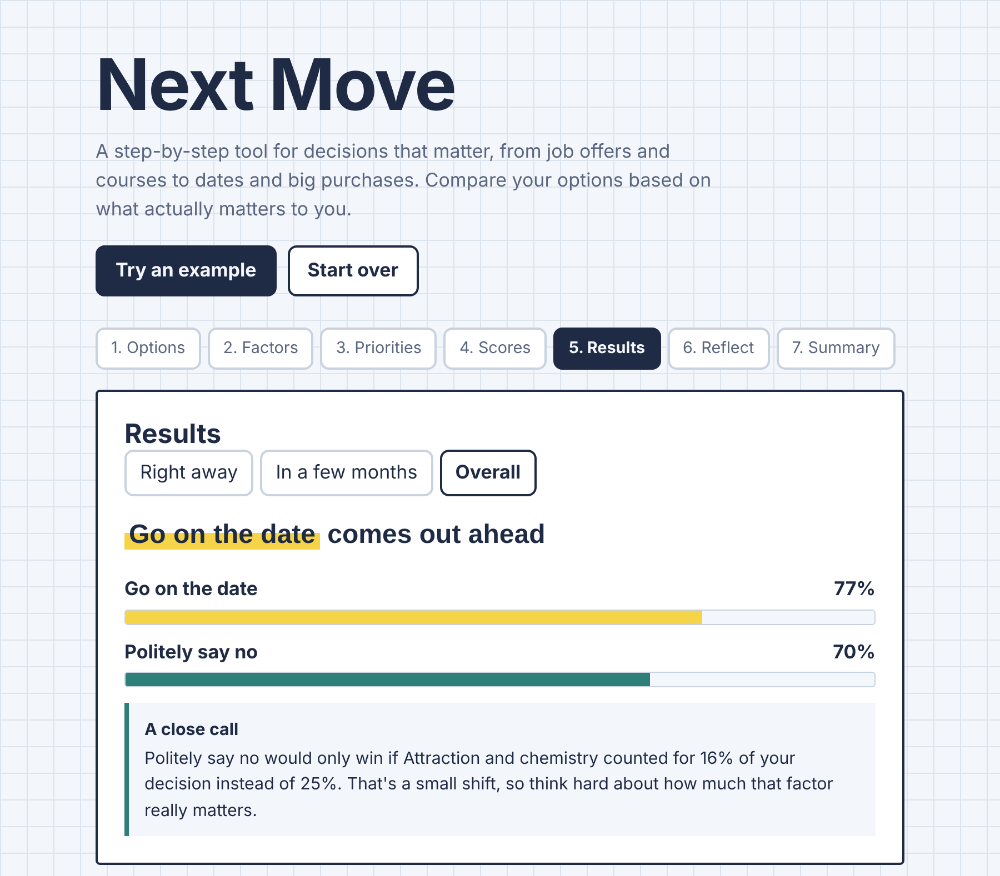

# Next Move

A step-by-step web app for decisions that matter: job offers, which course to study, whether to go on a date, where to live, big purchases, or anything else.

**Live demo:** https://EvonCLW.github.io/next-move/

## Why I built this

Most people make important choices with a gut feeling or a quick pros-and-cons list. Next Move combines proven decision-making methods into a guided flow, so you can see your reasoning clearly, test how solid it is, and still listen to your instincts.

## How it works

The app walks you through seven steps:

1. **Options**: choose the kind of decision, list your options (or add Yes / No for a single choice), and note which way you're leaning.
2. **Factors**: pick what matters from factors tailored to that kind of decision, and mark any dealbreakers.
3. **Priorities**: compare factors two at a time. The app turns your answers into weights.
4. **Scores**: rate each option on each factor, for the short term and the long term.
5. **Results**: see the ranking, which options are ruled out, and how solid the result is.
6. **Reflect**: the regret test, worst realistic outcomes, and how easy each choice is to undo.
7. **Summary**: a one-page summary bringing the analysis, your instinct and the regret test together. Printable as PDF.

## The methods behind it

| Method | What it does in the app |
|---|---|
| **Weighted scoring** | Each option's score = sum of (factor weight × your rating), shown as a percentage of the maximum. |
| **Pairwise comparison** (simplified Analytic Hierarchy Process) | Weights come from "A vs B" judgments, which are more honest than rating everything on its own. Weights are calculated with the geometric mean method. |
| **Consistency check** | Flags contradictory answers (A > B, B > C, but C > A) using the AHP consistency ratio (warns above 0.1). |
| **Dealbreakers** | Options scoring below a minimum on a must-have factor are ruled out, so strengths elsewhere can't hide them. |
| **Two time frames** | Short-term and long-term scores reveal options that start weak but grow, or the reverse. |
| **Sensitivity analysis** | Finds the smallest change to any single factor's weight that would flip the winner, and labels the result as close, fairly clear, or solid. |
| **Reflection prompts** | Regret minimization, worst-case thinking, and reversibility ("one-way vs two-way doors"). |

## Decision categories

| Category | Example factors | Time frames |
|---|---|---|
| Career | Salary, learning and growth, work-life balance, career capital | First year / in 3 years |
| Dating and relationships | Chemistry, feeling safe and respected, shared values, timing | Right away / in a few months |
| Study | Genuine interest, job prospects, affordability, fits my strengths | While studying / after graduating |
| Where to live | Affordability, career opportunities, close to family, safety | First year / in 3 years |
| Big purchase | Affordability, reliability, running costs, resale value | When I buy it / in 3 years |
| Something else | Happiness, personal growth, health, low risk | Short term / long term |

Each category has its own built-in example. Adding a new category only means adding one entry to the `CATEGORIES` object in the code.

## Features

- Guided seven-step flow with free navigation between steps
- Six decision categories, each with ten ready-made factors, plus your own
- One-click Yes / No options for single choices
- Live weight chart as you answer trade-off questions
- Ranked results for the short term, long term, or overall
- Printable decision summary
- Example decision to try instantly
- Saves progress in your browser (no account needed)
- Works on mobile, supports dark mode and keyboard navigation

## Built with

- HTML, CSS and JavaScript (no frameworks, no build step)
- Hosted on GitHub Pages

## Roadmap

- [ ] Decision journal to save and revisit past decisions
- [ ] Outcome review: rate how a decision turned out months later
- [ ] Bias checks (sunk cost, status quo, fear of missing out)
- [ ] Optional AI assistant that asks probing questions

## Run it locally

Download this repo and open `index.html` in your browser.

## Author

Made by [EvonCLW](https://github.com/EvonCLW)
